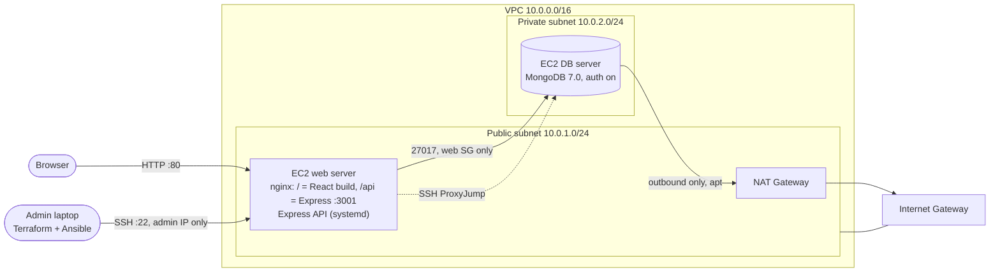

# TravelMemory on AWS with Terraform + Ansible

Deploys the [TravelMemory](https://github.com/UnpredictablePrashant/TravelMemory) MERN application to AWS:

- **Terraform** builds the infrastructure: VPC, public and private subnets, Internet Gateway, NAT Gateway, route tables, security groups, an IAM role and two EC2 instances.
- **Ansible** configures the servers: OS hardening, MongoDB on the private DB server, and Node.js, the Express API, the React build and nginx on the public web server.

The full write-up is in **[docs/REPORT.md](docs/REPORT.md)**. Screenshots are in [docs/screenshots](docs/screenshots).



## Repository layout

```
terraform/            AWS infrastructure (VPC, subnets, IGW, NAT, routes, SGs, IAM, EC2, outputs)
  tests/              Offline `terraform test` with a mocked AWS provider
ansible/
  site.yml            Main playbook (4 plays: common → mongodb → web stack → smoke test)
  roles/common        apt updates, swap, SSH hardening, UFW, fail2ban, sysctl, unattended-upgrades
  roles/mongodb       Official MongoDB 7.0 repo, auth enabled, admin + least-privilege app user
  roles/nodejs        NodeSource Node.js 20 (with npm)
  roles/nginx         Static React files + /api reverse proxy + security headers
  roles/app           Clone repo, npm ci, .env files, systemd service, React production build
  group_vars/         Variables (passwords live in an Ansible Vault file)
lab/                  Local Docker lab used to test the playbooks end to end
docs/                 Report and screenshots
```

## Prerequisites (on your laptop)

| Tool | Version | Notes |
|------|---------|-------|
| AWS account + IAM user with programmatic access | – | `aws configure` |
| AWS CLI | v2 | |
| Terraform | ≥ 1.7 | OpenTofu works too |
| Ansible | ≥ 2.15 (`pip install ansible`) | Linux, macOS or **WSL on Windows** |
| Python 3, `ssh` | – | |

## Deploy, step by step

### 1. AWS CLI

```bash
aws configure                     # access key, secret key, region ap-south-1, output json
aws sts get-caller-identity       # confirms you are authenticated
```

### 2. Terraform: build the infrastructure

```bash
cd terraform
cp terraform.tfvars.example terraform.tfvars   # optional: region, instance types, admin_cidr
terraform init
terraform plan -out tfplan
terraform apply tfplan
terraform output                               # web_public_ip, app_url, ssh_web, ssh_db ...
```

Terraform also writes two files for Ansible:
- `ansible/keys/travelmemory-key.pem`, the generated SSH private key
- `ansible/inventory/hosts.ini`, with the real IPs and the bastion `ProxyCommand` for the DB server

SSH to the web server is opened only to your current public IP, which is auto-detected. To set it yourself, use `admin_cidr = "x.x.x.x/32"` in `terraform.tfvars`.

### 3. Ansible: configure and deploy

```bash
cd ../ansible
ansible-galaxy collection install -r requirements.yml

cp group_vars/all/vault.yml.example group_vars/all/vault.yml
# edit the two passwords (letters and digits are simplest), then encrypt:
ansible-vault encrypt group_vars/all/vault.yml

ansible all -m ping --ask-vault-pass             # web directly, db through the web server
ansible-playbook site.yml --ask-vault-pass
```

The last play runs a smoke test and prints `TravelMemory is live at http://<web_public_ip>`. Open that URL.

### 4. Clean up (important: the NAT Gateway and Elastic IPs are billed hourly)

```bash
cd ../terraform && terraform destroy
```

## Screenshots to take on AWS

The `docs/screenshots` folder already holds the app and lab evidence (see the [lab section](#how-this-was-tested)). When you deploy to your own AWS account, add these:

| # | What to capture | Where |
|---|-----------------|-------|
| A1 | `aws sts get-caller-identity` output | terminal |
| A2 | `terraform apply` ending in `Apply complete! Resources: N added` and the outputs | terminal |
| A3 | VPC → *Your VPCs*: `travelmemory-vpc` | AWS console |
| A4 | VPC → *Subnets*: public + private subnets | AWS console |
| A5 | VPC → *Route tables*: public (0.0.0.0/0 → igw) and private (0.0.0.0/0 → nat) | AWS console, **Routes** tab |
| A6 | VPC → *NAT gateways* and *Internet gateways* | AWS console |
| A7 | EC2 → *Instances*: `travelmemory-web` (public IP) and `travelmemory-db` (no public IP) | AWS console |
| A8 | EC2 → *Security groups*: inbound rules of web-sg and db-sg | AWS console |
| A9 | IAM → *Roles* → `travelmemory-ec2-role` permissions | AWS console |
| A10 | `ansible-playbook site.yml` PLAY RECAP with `failed=0` and the "live at" message | terminal |
| A11 | The app at `http://<web_public_ip>`: home page, add-trip form, trip details | browser |
| A12 | `http://<web_public_ip>/api/health` → `{"status":"ok","db":"connected"}` | browser |
| A13 | `ssh -J` into the DB server and run `sudo ufw status`; `sudo systemctl status mongod` | terminal |

## How this was tested

The playbooks were run end to end against two Ubuntu 22.04 containers that stand in for the EC2 instances: same users, SSH keys, systemd and IP layout (web `10.0.1.10`, db `10.0.2.10` reached only by ProxyJump). The run went from fresh servers to a working app in about 4.5 minutes, and a second run made **0 changes** (idempotent). See [lab/README.md](lab/README.md).

Terraform was checked with `fmt`, `validate` and `terraform test`, an offline plan with a mocked AWS provider and assertions on the network and security rules. `ansible-lint` passes with the `production` profile.

| Screenshot | Shows |
|---|---|
| [01](docs/screenshots/01-home-empty.png) – [05](docs/screenshots/05-experience-details.png) | React UI: empty home, add-trip form with image upload, save, list, detail page |
| [06](docs/screenshots/06-api-health.png), [07](docs/screenshots/07-api-trips-json.png) | Express API through nginx `/api` (health + trips JSON) |
| [08](docs/screenshots/08-terraform-validate-test.png) | Terraform validate + tests |
| [09](docs/screenshots/09-ansible-run-start.png), [10](docs/screenshots/10-ansible-run-end.png), [11](docs/screenshots/11-ansible-idempotent-rerun.png) | Ansible full run, smoke test, idempotent re-run |
| [12](docs/screenshots/12-security-checks.png) | Firewall, SSH and MongoDB hardening verified from outside |
| [13](docs/screenshots/13-mongodb-users-and-data.png), [14](docs/screenshots/14-backend-env.png) | MongoDB users and stored trips; backend environment |
