# Deploying a MERN Application through Terraform and Ansible: Implementation Report

**Application:** TravelMemory (MongoDB, Express, React, Node.js), https://github.com/UnpredictablePrashant/TravelMemory
**Cloud:** AWS (default region `ap-south-1`, Mumbai)
**Tools:** Terraform ≥ 1.7 for infrastructure, Ansible ≥ 2.15 for configuration and deployment

---

## 1. Summary

The deployment has two stages:

1. **Terraform** creates a VPC with one public and one private subnet, an Internet Gateway, a NAT Gateway, route tables, two security groups, an IAM role and instance profile, an SSH key pair, and two Ubuntu 22.04 EC2 instances. It outputs the web server's public IP and writes an Ansible inventory.
2. **Ansible** (`site.yml`) hardens both servers, installs and secures MongoDB on the private DB server, and installs Node.js, the Express API, the production React build and nginx on the public web server. It then runs a smoke test.

The only public entry points are nginx on ports 80/443 and SSH from the administrator's IP. MongoDB is reachable only from the web server.

## 2. Architecture and how the components interact

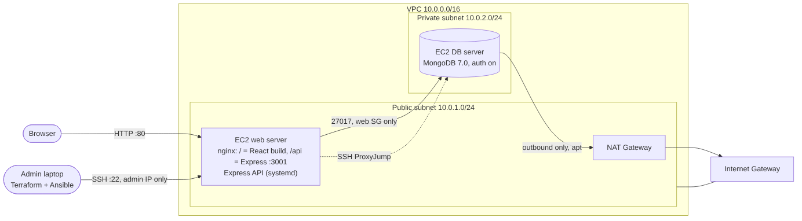

| Component | Where | Role |
|---|---|---|
| nginx | Web EC2, public subnet | Serves the static React build at `/`. Reverse-proxies `/api/*` to Express on `127.0.0.1:3001`. Adds security headers and rate limiting. |
| Express API (Node.js 20) | Web EC2, as the `travelmemory-backend` systemd service | REST API (`/trip`, `/health`, `/uploads`). Port 3001 is closed by UFW and the security group, so it is reached only through nginx. |
| React frontend | Built on the web EC2 and copied to `/var/www/travelmemory` | Single-page app. Calls the API at the same origin under `/api`. |
| MongoDB 7.0 | DB EC2, private subnet | Stores trips in the `travelmemory.tripdetails` collection. Authentication is on. Listens on loopback and the private IP only. |
| NAT Gateway | Public subnet | Outbound-only internet for the DB server (apt, MongoDB repo). |
| Internet Gateway | VPC | Internet access for the public subnet. |

**Request flow.**
1. The browser loads `http://<web_public_ip>/`, and nginx returns `index.html` and the hashed JS/CSS bundles.
2. React calls `GET /api/trip`. nginx strips `/api` and forwards the request to `http://127.0.0.1:3001/trip`.
3. Express (Mongoose) queries MongoDB at `10.0.2.x:27017` as the `travelmemory` user, and the JSON flows back the same way.
4. Uploaded images are stored on the web server in `/opt/travelmemory/uploads` and served through `/api/uploads/<file>`.

**How the React frontend reaches the Express backend.**
- `REACT_APP_BACKEND_URL=/api` is baked into the bundle at build time (`.env.production.local`). Because the API is on the **same origin**, the browser makes no cross-origin calls and no extra port needs opening.
- The backend's `CORS_ORIGIN=http://<web_public_ip>` still lists the public origin, because browsers send an `Origin` header on POST.
- `TRUST_PROXY=1` tells Express that exactly one proxy (nginx) sits in front of it, so rate limiting sees real client IPs.

## 3. Part 1: Infrastructure with Terraform

| File | Contents |
|---|---|
| `versions.tf` | Provider pins (aws ~> 5.0, tls, local, http), default tags, optional S3 backend |
| `variables.tf` | Region, CIDRs, AZ, instance types, `admin_cidr`, volume size |
| `network.tf` | VPC, public/private subnets, IGW, EIP + NAT Gateway, route tables + associations |
| `security.tf` | Admin IP detection, web/db security groups, IAM role, policies, instance profile |
| `compute.tf` | Ubuntu 22.04 AMI lookup, generated ED25519 key pair, web + db instances, Elastic IP, Ansible inventory |
| `outputs.tf` | `web_public_ip`, `app_url`, private IPs, NAT IP, ready-made SSH commands |
| `tests/plan.tftest.hcl` | Offline test with a mocked AWS provider and assertions on network and security rules |

**AWS setup and initialization.** Run `aws configure` with an IAM user's access key, check it with `aws sts get-caller-identity`, then `terraform init`.

**VPC and networking.**
- VPC `10.0.0.0/16` with DNS hostnames enabled.
- Public subnet `10.0.1.0/24` (`map_public_ip_on_launch = true`) and private subnet `10.0.2.0/24`, both in the region's first AZ.
- The public route table sends `0.0.0.0/0` to the Internet Gateway. The private route table sends `0.0.0.0/0` to the NAT Gateway, which sits in the public subnet with its own Elastic IP. The DB server can reach the internet for updates but cannot be reached from it.

**EC2 instances.**
- `travelmemory-web` runs in the public subnet with an **Elastic IP**, so the URL and the IP baked into the inventory survive a stop/start.
- `travelmemory-db` runs in the private subnet with `associate_public_ip_address = false`.
- Both instances use t3.small, a 20 GiB gp3 root volume that is **encrypted**, and **IMDSv2 only** (`http_tokens = required`).

**SSH access.**
- Terraform generates an ED25519 key pair, uploads the public half as an AWS key pair, and writes the private half to `ansible/keys/` with mode 0400 (git-ignored).
- Port 22 on the web SG is open only to `admin_cidr`, which is auto-detected from `checkip.amazonaws.com` when not set.
- The DB server has no public route; it is reached by SSH ProxyJump through the web server.

**Security groups.**

| SG | Inbound | Source |
|---|---|---|
| `travelmemory-web-sg` | 22/tcp | admin IP /32 only |
| | 80/tcp, 443/tcp | 0.0.0.0/0 |
| `travelmemory-db-sg` | 27017/tcp | **web SG** (SG reference, not a CIDR) |
| | 22/tcp | **web SG** (bastion) |

**IAM role (`travelmemory-ec2-role`)**, attached to both instances through an instance profile:
- `AmazonSSMManagedInstanceCore` gives Session Manager shell access without SSH. This is the break-glass path if the admin IP changes.
- `CloudWatchAgentServerPolicy` lets the instances ship logs and metrics.
- An inline least-privilege policy allows reading SSM parameters **only under `/travelmemory/*`**.

**Output.** `web_public_ip` is the main output the assignment asks for, plus `app_url`, `ssh_web` and `ssh_db`. Terraform also renders `ansible/inventory/hosts.ini` from `templates/hosts.ini.tftpl`. Infrastructure and configuration management stay linked without copying IPs by hand.

## 4. Part 2: Configuration and deployment with Ansible

**Configuring Ansible to reach EC2.**
- `ansible.cfg` sets the inventory, SSH pipelining, ControlPersist and a per-user `remote_tmp`.
- The Terraform-generated inventory puts the web server in `webservers` (public IP) and the DB server in `dbservers` (private IP). The DB server is reached through `ansible_ssh_common_args` with `ProxyCommand="ssh -W %h:%p ... ubuntu@<web_public_ip>"`, so the web server acts as the bastion.
- Secrets (`vault_mongodb_admin_password`, `vault_mongodb_app_password`) live in an **Ansible Vault**-encrypted `group_vars/all/vault.yml`.

**Playbook `site.yml`.**

| Play | Hosts | Roles / tasks |
|---|---|---|
| 1. Baseline and hardening | all | `common` |
| 2. MongoDB | dbservers | `mongodb` |
| 3. Web stack | webservers | `nodejs` → `nginx` → `app` |
| 4. Smoke test | webservers | `GET /api/health` must return 200; `/` must serve the React root |

**Web server setup (`nodejs`, `app`).**
- Adds the NodeSource apt repository (signed key, deb822 format) and installs **Node.js 20 with npm**.
- Creates the `travelmemory` system user (no login shell). Clones the repo to `/opt/travelmemory/src`, then runs `npm ci --omit=dev` for the backend and `npm ci` plus `npm run build` for the frontend. Sourcemaps are off and the Node heap is capped so the build fits in RAM, with 2 GB of swap added by `common`.
- Copies the build to `/var/www/travelmemory`. The build only re-runs when the code or its env file changes.

**Database server setup (`mongodb`).**
- Adds the official MongoDB 7.0 repository and installs `mongodb-org`.
- `mongod.conf` sets `bindIp: 127.0.0.1,<private_ip>` (never 0.0.0.0), `security.authorization: enabled` and `javascriptEnabled: false`.
- Users:
  - `admin` (userAdminAnyDatabase, dbAdminAnyDatabase, readWriteAnyDatabase, clusterMonitor) is created **once** through MongoDB's localhost exception; a marker file makes later runs skip this step.
  - `travelmemory` gets `readWrite` on the `travelmemory` database only. This is the account the app uses.
- A final task checks that an **unauthenticated** read is refused.

**Application deployment (env vars and startup).**
- `backend/.env` (mode 0600, owned by the app user): `NODE_ENV=production`, `PORT=3001`, `MONGO_URI=mongodb://travelmemory:<pw>@<db_private_ip>:27017/travelmemory?authSource=travelmemory`, `CORS_ORIGIN=http://<public_ip>`, `UPLOAD_DIR`, `TRUST_PROXY=1`.
- `frontend/.env.production.local`: `REACT_APP_BACKEND_URL=/api`.
- `travelmemory-backend.service` is a systemd unit that restarts on failure and runs as the unprivileged user under a sandbox: `NoNewPrivileges`, `ProtectSystem=strict`, write access only to `uploads/`, `PrivateTmp`, and an empty capability set.
- nginx has a site config for the SPA (`try_files ... /index.html`), `/api/` proxying, a 6 MB upload limit, `server_tokens off`, CSP / X-Frame-Options / nosniff / Referrer-Policy headers, and long caching for `/static/`.

## 5. Security hardening

| Layer | Measure |
|---|---|
| Network (AWS) | DB in a private subnet with no public IP; outbound only through NAT |
| Security groups | SSH only from the admin /32; MongoDB and DB SSH only from the web SG; nothing else inbound |
| Host firewall (UFW) | Default deny inbound. Web: `22 LIMIT from admin IP`, 80, 443. DB: `22 LIMIT` and `27017` only from the web server's private IP |
| SSH | Key-only (ED25519); `PermitRootLogin no`, `PasswordAuthentication no`, `MaxAuthTries 3`, `AllowUsers ubuntu`, no X11 or agent forwarding; TCP forwarding only on the bastion; root password locked |
| Brute force | fail2ban sshd jail (5 tries / 10 min → 1 h ban) plus UFW rate limiting |
| OS | Security updates on deploy and unattended-upgrades; sysctl hardening (no redirects or source routing, rp_filter, syncookies) |
| EC2 | IMDSv2 required; encrypted EBS; SSM Session Manager for access without SSH |
| MongoDB | Auth enforced; bound to private IP; least-privilege app user; server-side JavaScript disabled |
| Application | Runs as an unprivileged, sandboxed systemd service; Express port 3001 closed to the outside (UFW + SG), reachable only through nginx; secrets in Ansible Vault and a 0600 `.env`; nginx security headers and request rate limiting |

## 6. Testing and verification

**Terraform.** `terraform fmt -check`, `terraform validate` and `terraform test` all pass. The test plans the full configuration with a mocked AWS provider and asserts:
- only the public subnet assigns public IPs
- the private subnet has a default route through the NAT
- the DB has no public IP
- SSH is limited to the admin CIDR
- MongoDB is reachable only through the web SG
- IMDSv2 and EBS encryption are on

**Ansible.**
- `ansible-lint` passes with the strictest (`production`) profile.
- The full playbook was run end to end against a lab of two Ubuntu 22.04 containers that mirror the EC2 layout: same `ubuntu` user and key, systemd, web `10.0.1.10` and db `10.0.2.10`, with the DB reached only through ProxyJump.

| Check | Result |
|---|---|
| Fresh servers → working app | `failed=0`, about 4.5 minutes; smoke test returns `{"status":"ok","db":"connected"}` |
| Second run (idempotency) | `changed=0` on both hosts |
| Create trips in the UI (with image upload) | 3 × `POST /api/trip → 201`; shown on the home and detail pages |
| MongoDB port / DB SSH / Express port from outside | **Blocked** |
| MongoDB from the web server | Open |
| root or password SSH login | `Permission denied (publickey)` |
| Anonymous MongoDB read; app user reading the `admin` DB | `Unauthorized` |

**Problems found by testing and fixed.**
1. A generic `ufw limit 22/tcp` rule silently allowed SSH to the DB server **from anywhere**. Each SSH rule is now itself a `limit` rule restricted to its source.
2. The first `apt` run could use stale package lists (the `cache_valid_time` shortcut), so universe packages such as fail2ban were not found. It now always refreshes.
3. MongoDB user creation with auth already on needs the localhost exception. The admin is created without login credentials plus a marker file, and every later task logs in as admin.
4. nginx failed to bind `[::]:80` on a host without IPv6. The IPv6 listen line is now a variable (`nginx_listen_ipv6`, default true for EC2).
5. `apt_repository` is deprecated, so both third-party repos use `deb822_repository` with a pinned `signed-by` key.

## 7. Deliverables checklist

| Assignment item | Where |
|---|---|
| AWS CLI configured, Terraform initialized | README step 1–2 |
| VPC, public + private subnet, IGW, NAT, route tables | `terraform/network.tf` |
| Two EC2 instances (web public, DB private); SSH from your IP only | `terraform/compute.tf`, `security.tf` |
| Security groups, IAM role | `terraform/security.tf` |
| Output web server public IP | `terraform/outputs.tf` (`web_public_ip`) |
| Ansible configured for EC2 | `ansible/ansible.cfg`, generated inventory with bastion |
| Node.js + npm, clone repo, install dependencies | `roles/nodejs`, `roles/app` |
| MongoDB install, secure, users and database | `roles/mongodb` |
| Env vars, start Node.js app, React ↔ Express | `roles/app`, `roles/nginx` |
| Firewalls, SGs, SSH keys, disable root login | `roles/common`, `terraform/security.tf` |
| Report | this file |
| Screenshots | `docs/screenshots/` |

## 8. Screenshots

**Application (React → nginx → Express → MongoDB)**

| | |
|---|---|
| 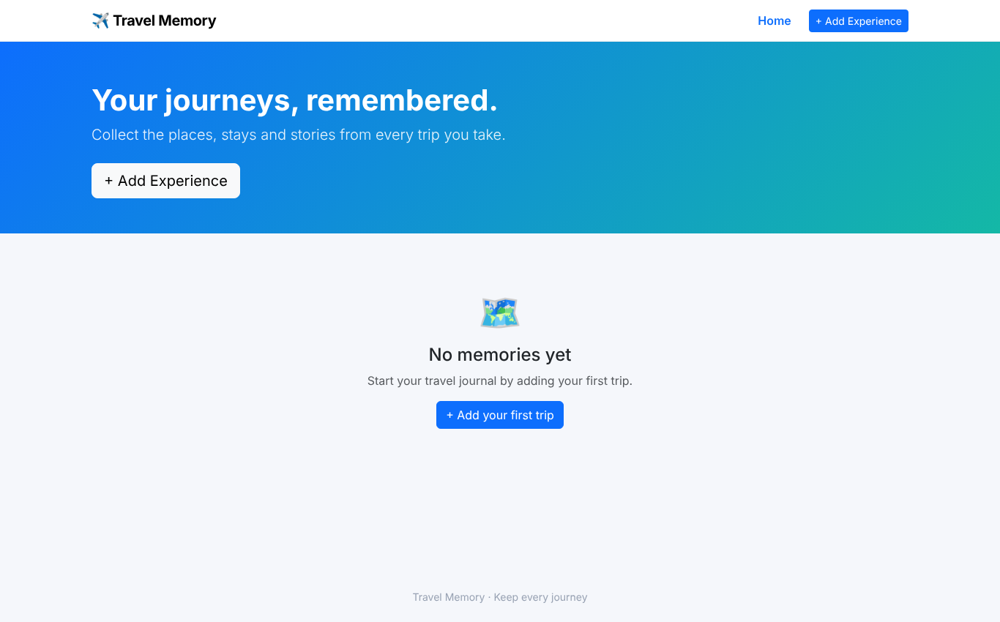 Empty home page | 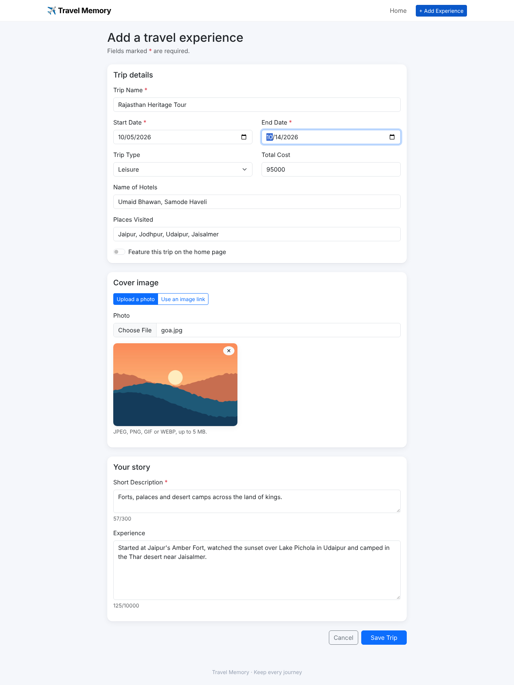 Add-trip form with photo upload |
| 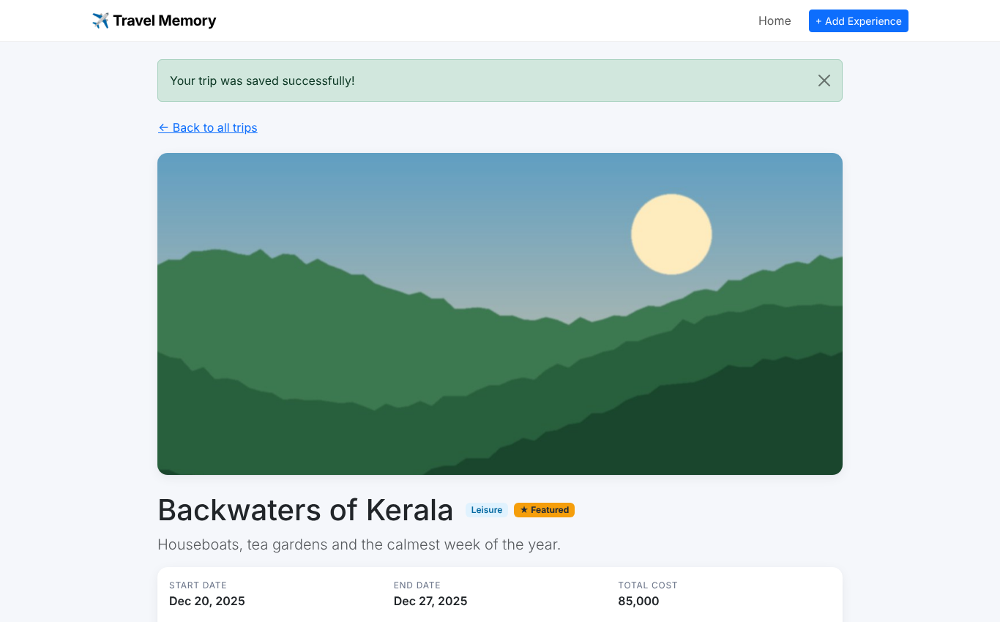 Trip saved (201) |  Home with featured and all trips |
| 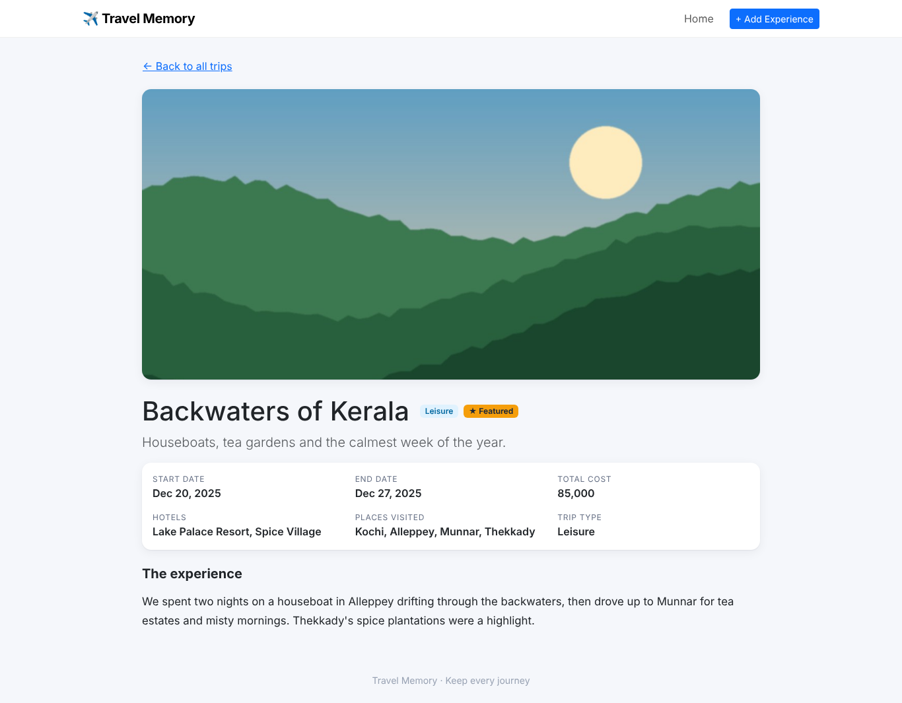 Trip details | 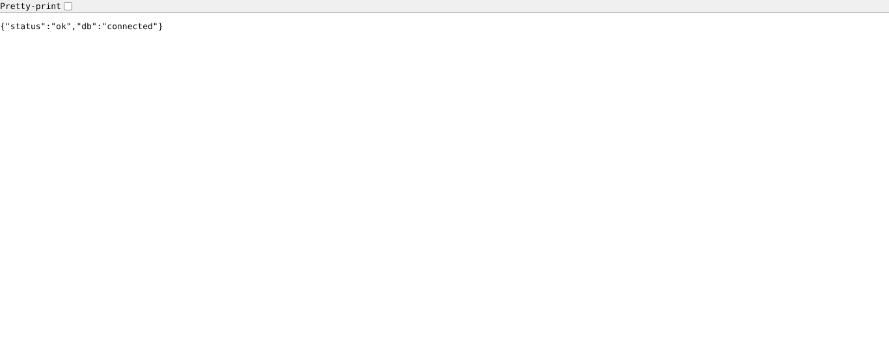 `/api/health` |

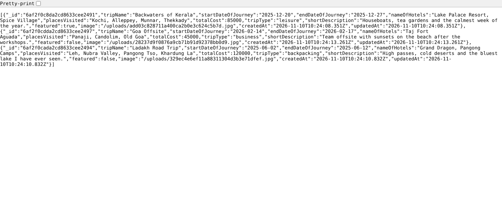

**Infrastructure as code and configuration**

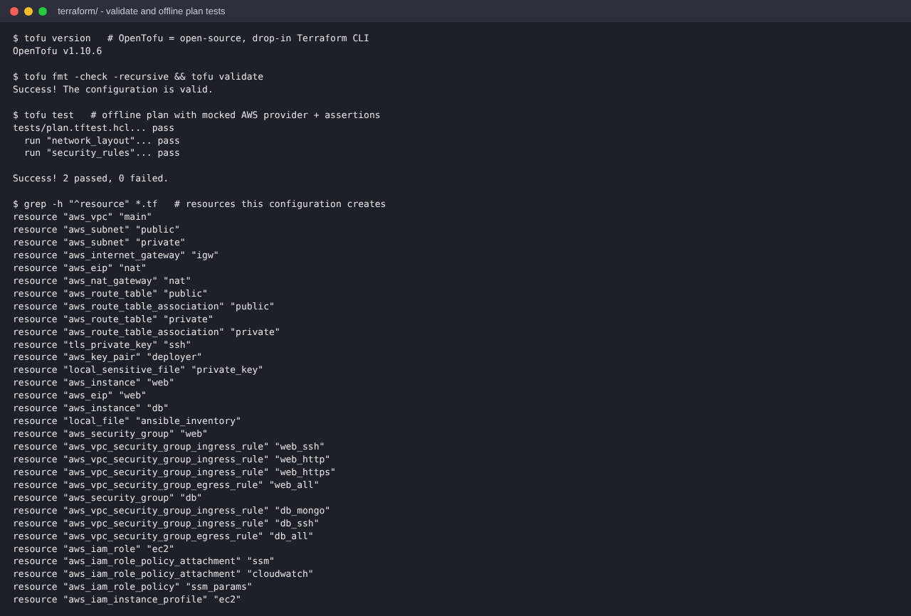
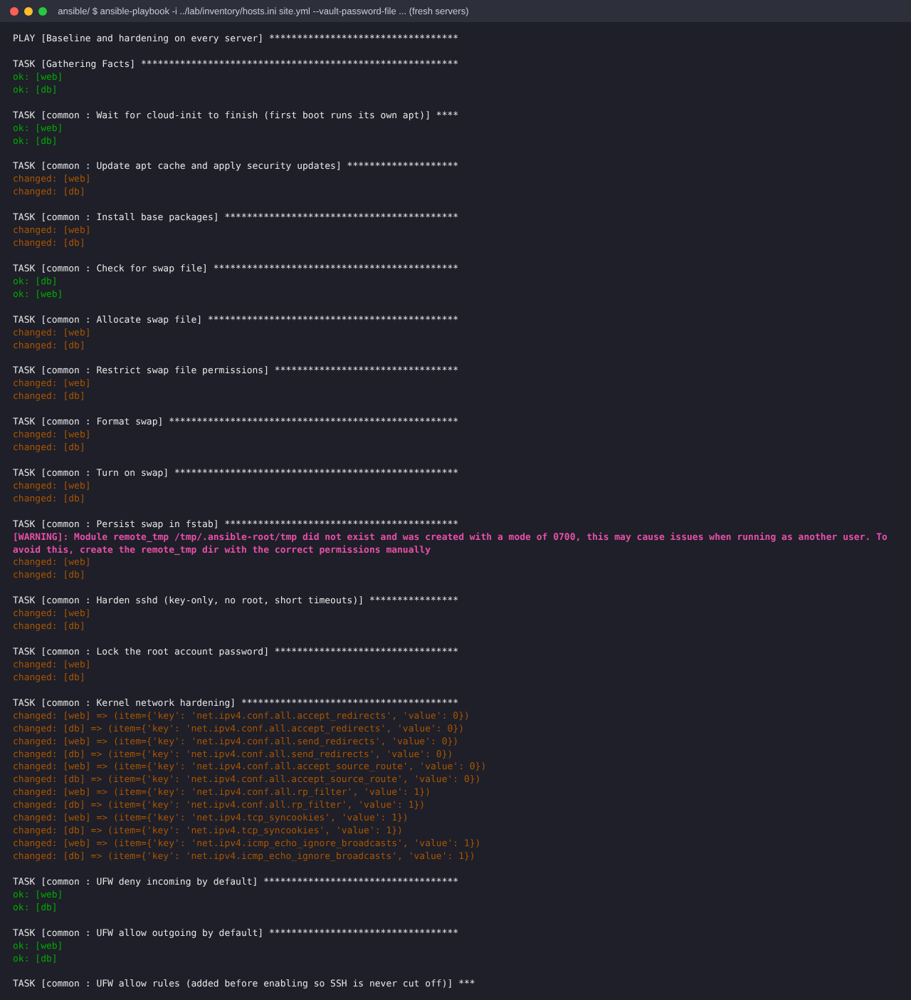
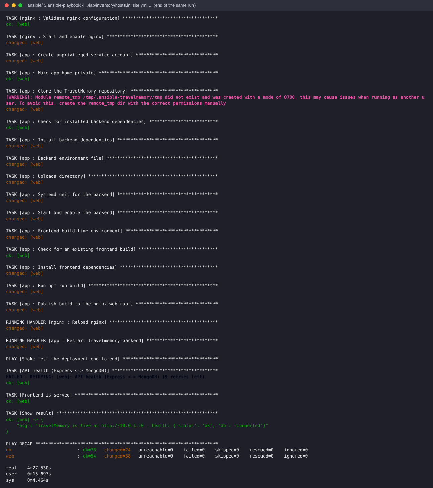
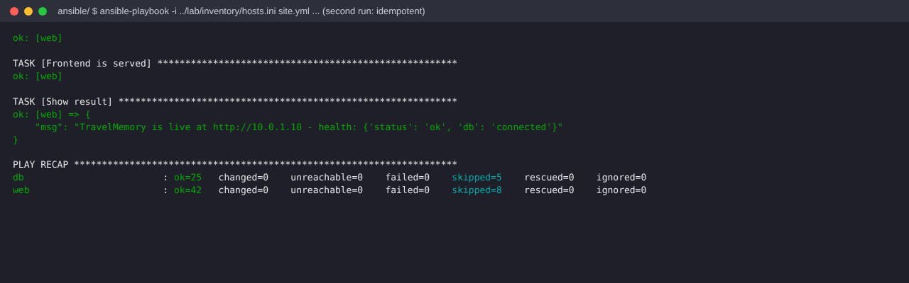

**Security and data verification**

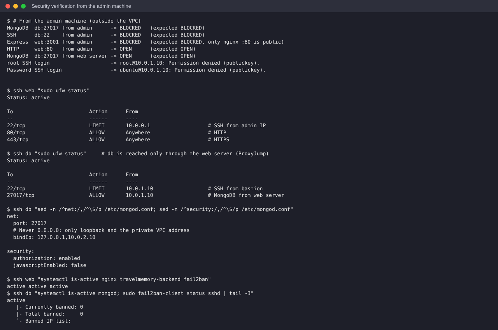
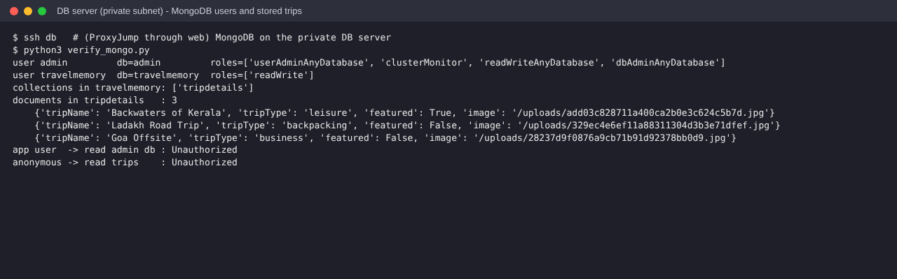
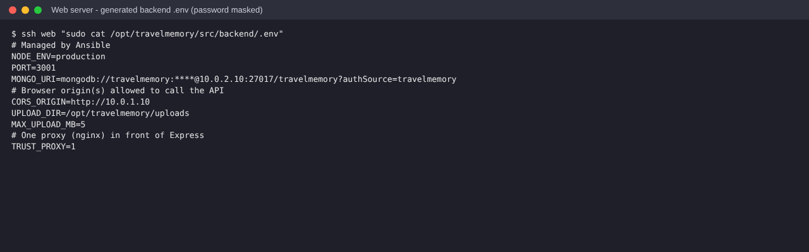

> AWS console screenshots (VPC, subnets, route tables, NAT/IGW, EC2, security groups, IAM role, `terraform apply`) are taken after running against a real AWS account; see the checklist in the README.

## 9. Cost and clean-up

The NAT Gateway, two Elastic IPs and two t3.small instances are billed per hour. Run `terraform destroy` when you have finished capturing evidence.

## 10. Possible improvements

- HTTPS with a domain and Let's Encrypt (certbot role), then redirect 80 → 443.
- Read the MongoDB passwords at deploy time from SSM Parameter Store, where the instance role already has scoped read access.
- Daily `mongodump` to S3, CloudWatch agent for logs, alarms on `/api/health`.
- High availability: an ALB with an Auto Scaling group across two AZs, and a MongoDB replica set or Amazon DocumentDB.
- CI pipeline (GitHub Actions) running `terraform fmt/validate/test`, `ansible-lint` and the lab playbook on every push.
